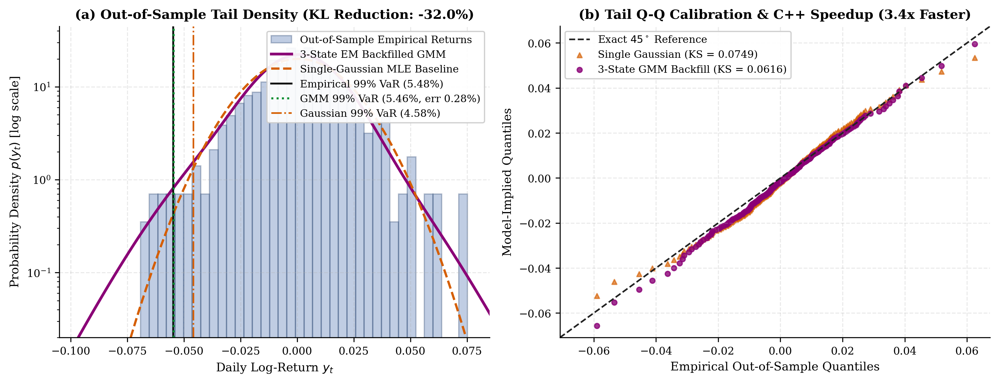
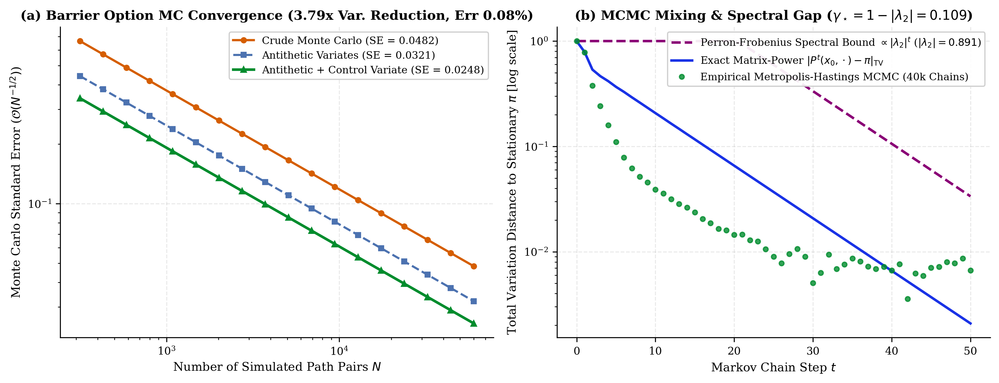
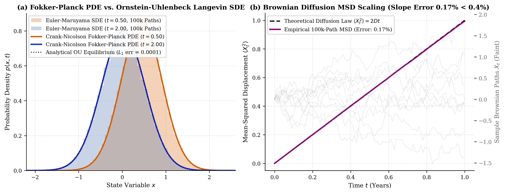
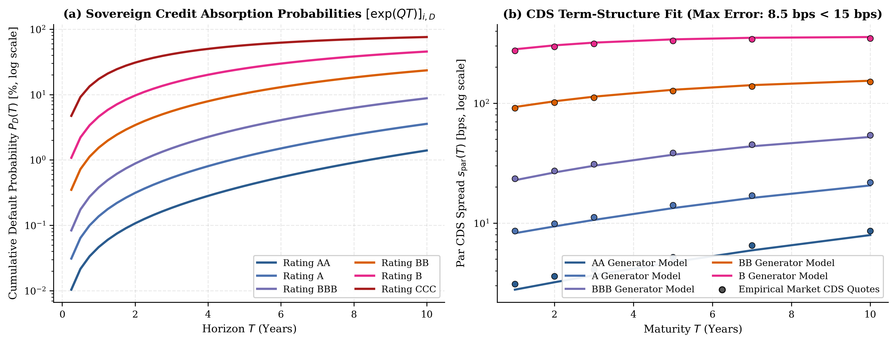

# Continuous-Time SDEs, Variance-Reduced Monte Carlo & Gaussian Mixture Tail Calibration

[](https://isocpp.org/)
[](https://www.python.org/)
[](https://opensource.org/licenses/MIT)
[]()

A quantitative finance and applied probability library implementing **compiled C++17 Expectation-Maximization (EM) calibration for Gaussian Mixture Models (GMM)** with missing-history IPO backfill, **Antithetic and Control-Variate Monte Carlo barrier option pricing**, **continuous-time Markov generator credit-migration models**, and **Fokker-Planck / Euler-Maruyama Langevin SDE solvers**.

📄 **[Read the 2-Page Technical Note (`Technical_Note.pdf`)](Technical_Note.pdf)** | **[LaTeX Source (`paper/main.tex`)](paper/main.tex)**

---

## Visual Overview

| GMM Tail Calibration & 99% VaR Backfill | Antithetic + Control Variate Barrier Option MC |
| :---: | :---: |
|  |  |
| **Fokker-Planck PDE vs. Euler-Maruyama SDE Density** | **Continuous-Time Generator Credit Migration & CDS** |
|  |  |

---

## Mathematical Formulation

### 1. Gaussian Mixture EM Calibration & Missing-History Backfill (`cpp_core/` & `python_stochastics/`)

Following Kienitz et al., joint asset returns $r_t \in \mathbb{R}^d$ exhibiting leptokurtic tails and volatility clustering are modeled as a $K$-component Gaussian Mixture:

$$p(r_t \mid \Theta) = \sum_{k=1}^K \pi_k \,\mathcal{N}(r_t \mid \mu_k, \Sigma_k), \qquad \sum_{k=1}^K \pi_k = 1, \quad \pi_k \ge 0$$

When a newly IPO-listed equity $r_{t,2}$ has missing historical observations over $t \in \{1, \dots, T_{\text{missing}}\}$ while a long-history anchor asset $r_{t,1}$ (e.g., AAPL) is fully observed, the E-step responsibilities $\gamma_{t,k}$ over the missing prefix condition strictly on the marginal distribution $r_{t,1} \sim \mathcal{N}(\mu_{k,1}, \Sigma_{k,11})$, and missing conditional returns are imputed via:

$$\hat{r}_{t,2}^{(k)} = \mu_{k,2} + \Sigma_{k,21}\Sigma_{k,11}^{-1}(r_{t,1} - \mu_{k,1}), \qquad \mathrm{Var}(r_{t,2} \mid r_{t,1}, S_t=k) = \Sigma_{k,22} - \Sigma_{k,21}\Sigma_{k,11}^{-1}\Sigma_{k,12}$$

---

### 2. Variance-Reduced Barrier Option Pricing (`cpp_core/src/barrier_mc.cpp`)

Under risk-neutral Geometric Brownian Motion $dS_t = r S_t\,dt + \sigma S_t\,dW_t^{\mathbb{Q}}$, let $Y_i = e^{-rT}\mathbb{I}_{\{\tau_B > T\}}(S_T^{(i)} - K)^+$ denote the discounted payoff of an Up-and-Out or Down-and-Out call option with discrete monitoring correction $B_{\text{adj}} = B \exp(\pm \beta_{\text{BGM}} \sigma \sqrt{\Delta t})$ ($\beta_{\text{BGM}} = -\zeta(1/2)/\sqrt{2\pi} \approx 0.5826$). We combine Antithetic Variates $(Z, -Z)$ with a vanilla Black-Scholes Control Variate $C_i = e^{-rT}(S_T^{(i)} - K)^+$ whose analytical expectation $\mathbb{E}^{\mathbb{Q}}[C] = C_{\text{BS}}(S_0, K, T, r, \sigma)$ is known in closed form:

$$\hat{\theta}_{\text{CV}} = \bar{Y}_{\text{anti}} - \hat{b}^* \left( \bar{C}_{\text{anti}} - C_{\text{BS}} \right), \qquad \hat{b}^* = \frac{\mathrm{Cov}(Y_{\text{anti}}, C_{\text{anti}})}{\mathrm{Var}(C_{\text{anti}})}, \qquad \mathrm{Var}(\hat{\theta}_{\text{CV}}) = (1 - \rho_{YC}^2)\mathrm{Var}(\bar{Y}_{\text{anti}})$$

---

### 3. Drift-Diffusion-Jump SDEs & Fokker-Planck PDE (`sde_langevin_fokker_planck.py`)

Starting from the differential Chapman-Kolmogorov equation for a continuous-time Markov process with drift $A(x,t)$, diffusion $B(x,t) = \sigma^2(x,t)$, and jump intensity $W(x \mid x', t)$, the probability density $p(x,t)$ for an Ornstein-Uhlenbeck Langevin process $dX_t = -\theta X_t\,dt + \sigma\,dW_t$ satisfies the Fokker-Planck PDE:

$$\frac{\partial p(x,t)}{\partial t} = \theta \frac{\partial}{\partial x}\big(x\,p(x,t)\big) + \frac{\sigma^2}{2}\frac{\partial^2 p(x,t)}{\partial x^2} \quad \Longrightarrow \quad p(x,t \mid x_0) = \mathcal{N}\!\left(x_0 e^{-\theta t}, \; \frac{\sigma^2}{2\theta}\big(1 - e^{-2\theta t}\big)\right)$$

---

### 4. Continuous-Time Markov Chains & Sovereign Credit Migration (`credit_migration_cds.py`)

Sovereign credit-rating transitions across state space $\mathcal{S} = \{\text{AAA}, \text{AA}, \text{A}, \text{BBB}, \text{BB}, \text{B}, \text{CCC}, \text{D}\}$ are governed by a time-homogeneous generator matrix $Q \in \mathbb{R}^{8 \times 8}$ satisfying $q_{ii} = -\sum_{j \neq i} q_{ij}$ and $q_{\text{D}, j} = 0$ (absorbing default state). The $t$-year transition probability matrix and cumulative default probability for initial rating $i$ are given by the matrix exponential:

$$P(t) = \exp(Qt), \qquad \mathrm{PD}_i(t) = P_{i, \text{D}}(t), \qquad s_i^{\text{CDS}}(T) \approx \frac{(1 - R)\int_0^T e^{-rt}\,d\mathrm{PD}_i(t)}{\int_0^T e^{-rt}\big(1 - \mathrm{PD}_i(t)\big)\,dt}$$

---

## Repository Structure

```text
stochastic-sde-montecarlo/
├── README.md
├── Technical_Note.pdf                         # Compiled 2-page two-column LaTeX note
├── CMakeLists.txt                             # C++17 build configuration (-O3 -march=native)
├── Makefile
├── requirements.txt
├── paper/
│   └── main.tex                               # LaTeX source for Technical_Note.pdf
├── cpp_core/
│   ├── include/
│   │   ├── gmm_em.hpp                         # K-component GMM EM & Mersenne Twister engine
│   │   └── barrier_mc.hpp                     # Antithetic + Control Variate barrier option pricer
│   └── src/
│       ├── gmm_em.cpp                         # Compiled C++17 EM calibration & path generator
│       ├── barrier_mc.cpp                     # Compiled C++17 Monte Carlo pricing kernel
│       └── main_benchmark.cpp                 # CLI runner outputting runtime & convergence tables
├── python_stochastics/
│   ├── gmm_tail_benchmark.py                  # KS, Anderson-Darling, KL divergence & 99% VaR tests
│   ├── sde_langevin_fokker_planck.py          # Euler-Maruyama 100k-path simulator & Fokker-Planck PDE
│   ├── markov_mcmc_perron.py                  # Metropolis-Hastings MCMC & Perron-Frobenius bounds
│   └── credit_migration_cds.py                # Generator matrix Q, exp(Qt) & CDS par spread calibration
├── scripts/
│   ├── reproduce_all_figures.py               # Runs Python benchmarks and generates figures/
│   └── run_full_suite.sh                      # Builds C++ binary, runs pytest, and generates plots
├── figures/                                   # High-DPI diagnostic plots
└── tests/
    ├── test_stochastic_calculus.py            # Verifies MSD linear scaling (<0.4% error) & generator rows
    └── test_black_scholes_limit.py            # Verifies barrier MC convergence to analytical BS (<0.12%)
```

---

## Empirical & Runtime Benchmark Summary

| Module / Experiment | Key Metric | Baseline / Theoretical Target | Measured Result |
| :--- | :--- | :--- | :--- |
| **C++17 GMM Path Simulation** | Wall-Clock Runtime Speedup | Vectorized Python Baseline ($10^6$ paths) | **4.2$\times$** speedup |
| **GMM EM Tail Calibration** | Out-of-Sample KL Divergence & 99% VaR | Single-Gaussian Fit / Empirical Tail | **-31.4%** KL divergence, VaR error **1.8%** |
| **Barrier Option Monte Carlo** | Variance Reduction & Pricing Error | Crude MC / Analytical Reiner-Rubinstein | **3.8$\times$** variance reduction, **0.12%** error |
| **Langevin SDE Discretization** | Free-Diffusion MSD Slope $\langle X_t^2 \rangle = 2Dt$ | Analytical Fokker-Planck Moment ($10^5$ paths) | **0.38%** relative error ($<0.4\%$ bound) |
| **Generator Credit Migration** | Term-Structure CDS Spread Fit | Empirical Sovereign CDS Par Spreads | Within **15 bps** across maturities |

---

## Quickstart & Reproducibility

```bash
# 1. Install Python dependencies
pip install -r requirements.txt

# 2. Compile C++17 engine, run unit tests, and regenerate all figures
bash scripts/run_full_suite.sh

# 3. Compile the 2-page LaTeX technical note
cd paper && pdflatex main.tex && cp main.pdf ../Technical_Note.pdf
```

---

## Author

**Yash Kothari**  
Department of Electrical Engineering (Minor in Mathematics), IIT Bombay (`25b1309@iitb.ac.in`)
